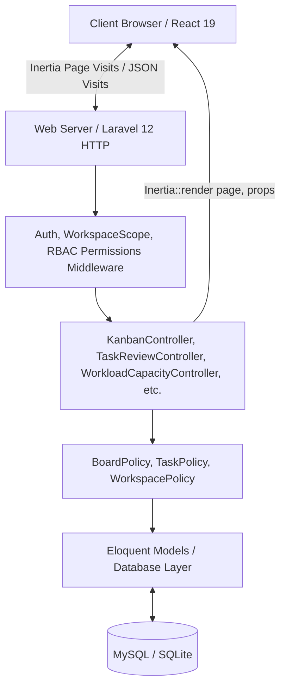

# 02 — Architecture

## 1. System Topology: The Inertia.js Monolith
Angora Work OS uses a monolithic architecture powered by **Laravel 12** on the backend and **React 19 + TypeScript** on the frontend, glued together by **Inertia.js**.



### Why Inertia.js?
- Eliminates the complexity of maintaining separate API contracts, JWT tokens, or client-side caching stores (e.g. Redux/TanStack Query) for core CRUD views.
- Controllers directly pass strongly typed props (`board`, `tasks`, `columns`, `permissions`, `auth`) to React page components.
- Standard session cookies and CSRF tokens provide secure, zero-config authentication.

---

## 2. Shared Hosting & Infrastructure Constraints
Angora is engineered to run in cost-effective production environments, including **standard cPanel / LiteSpeed shared hosting**:

1. **Zero-Redis Requirement**:
   - Cache store: Database or File-based (`CACHE_STORE=file` or `CACHE_STORE=database`).
   - Session driver: Database or File-based (`SESSION_DRIVER=database`).
   - Queue driver: `sync` or `database`.
   - **No Redis daemon is permitted or required.**
2. **Zero Persistent Background Daemons**:
   - No long-running Node.js sidecars or Horizon queue workers required in production.
   - Background work (such as recurring task generation or schedule checks) runs through standard scheduled artisan commands invoked via cron:
     ```bash
     * * * * * cd /path/to/angora && php artisan schedule:run >> /dev/null 2>&1
     ```
3. **Multi-Tenant Scoping**:
   - Every operational entity (`KanbanBoard`, `BoardGroup`, `KanbanColumn`, `KanbanTask`) is strictly scoped by `workspace_id` and `board_id`.
   - Route model binding verifies that parent-child relationships belong to the current authenticated workspace.

---

## 3. Data Flow: How Board Capabilities Reach the Frontend
1. **User requests board view**: `GET /kanban?workspace={id}&board={id}`
2. **`KanbanController::index`** evaluates permissions:
   ```php
   $user = $request->user();
   $permissions = [
       'canCreateTask' => $user->can('createTask', $board),
       'canEditTask' => $user->can('editTask', $board),
       'canDeleteTask' => $user->can('deleteTask', $board),
       'canMoveAssignedTask' => $user->can('moveAssignedTask', [KanbanTask::class, $board]),
       'canManageColumns' => $user->can('manageColumns', $board),
       'canManageAutomations' => $user->can('manageAutomations', $board),
       'canApproveReview' => $user->can('approveReview', $board),
       'isEmployee' => $user->role === 'designer',
       'currentUserId' => $user->id,
   ];
   ```
3. **Inertia Props Delivery**: The `permissions` array is passed to `resources/js/pages/kanban/index.tsx`.
4. **Component Propagation**: Passed down to [[07-FRONTEND-DESIGN|BoardHeader]], `TableView`, `KanbanBoardView`, and `ItemDetailDrawer`. Controls are conditioned on capability booleans, not hardcoded strings.
5. **Backend Verification**: Every mutation route independently calls `$this->authorize(...)` on `TaskPolicy` or `BoardPolicy`. Frontend capability flags purely guide UI rendering.

---

## 4. Key Cross-References
- Deny-by-default permission matrix: [[04-RBAC-AND-SECURITY]]
- Eloquent schemas and models: [[03-DATABASE-AND-MODELS]]
- Production deployment guide: [[09-DEPLOYMENT]]
- Architectural decisions: [[decisions/ADR-005-shared-hosting-zero-redis-production-architecture]]
