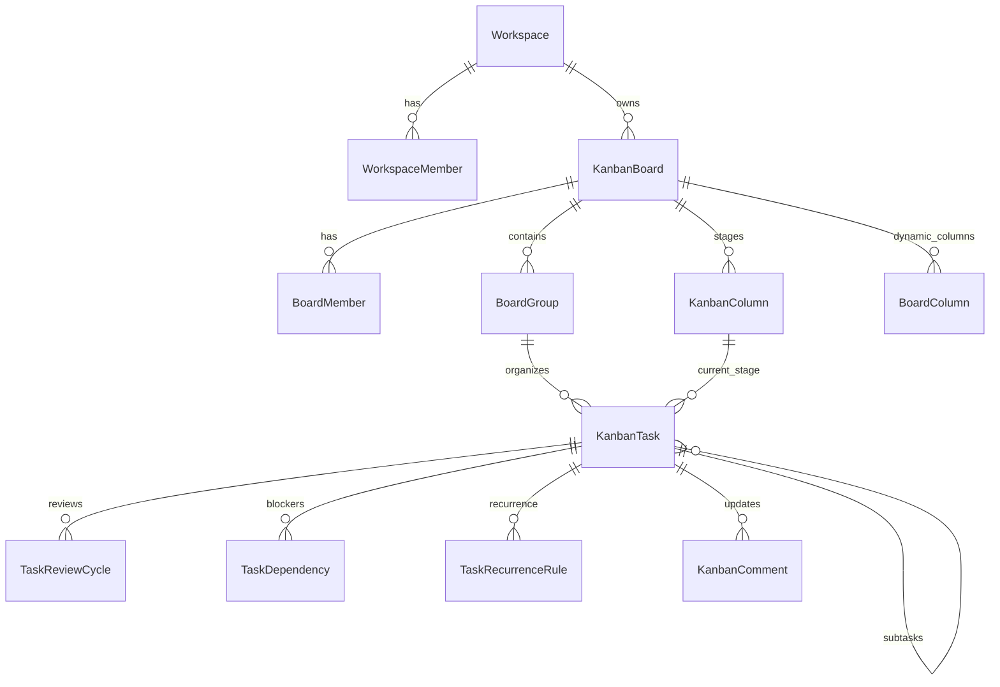

# 03 — Database & Models

## 1. Core Schema Topology

---

## 2. Key Eloquent Models

### `App\Models\KanbanTask`
The central work unit of Angora Work OS.
- **Attributes**:
  - `id`: Primary key (bigint unsigned)
  - `board_id`: Foreign key to `kanban_boards`
  - `group_id`: Foreign key to `board_groups` (swimlane/group container)
  - `column_id`: Foreign key to `kanban_columns` (workflow stage)
  - `parent_id`: Nullable foreign key to `kanban_tasks` for hierarchical subitems
  - `title`: String task headline
  - `description`: Nullable text brief / specifications
  - `assigned_to`: Nullable foreign key to `users` (primary assignee)
  - `priority`: Enum string (`Low`, `Medium`, `High`, `Urgent`)
  - `due_date`: Date string (`YYYY-MM-DD`)
  - `due_time`: Time string (`HH:MM:SS`)
  - `progress`: Integer `0` to `100`
  - `position`: Decimal / float for drag-and-drop lexical reordering
  - `custom_values`: Cast to `array` (JSON column storing dynamic column data: e.g. `designer_ids`, `project_manager`, `account_manager`, `service_type`)
  - `created_by`: Foreign key to `users`
- **Helper Methods**:
  - `isAssignedTo(User $user)`: Checks direct assignment (`assigned_to == user.id`), dynamic `designer_ids` array, `person` column, or parent task inheritance.
  - `isBlocked()`: Evaluates active blocker dependencies (`TaskDependency::where('task_id', $this->id)->where('type', 'blocked_by')`).

### `App\Models\KanbanColumn`
Represents workflow stages (Kanban columns).
- **Attributes**:
  - `board_id`: Foreign key to `kanban_boards`
  - `title`: Stage label (e.g., `Not Started`, `Working on it`, `For Review`, `Done`)
  - `category`: Category string (`not_started`, `in_progress`, `in_review`, `completed`)
  - `semantic_category`: Normalized stage mapping for automated transitions
  - `color`: Hex color string
  - `position`: Integer ordering

### `App\Models\BoardColumn`
Represents dynamic table columns configured on a board (Monday.com-style custom columns).
- **Attributes**:
  - `board_id`: Foreign key to `kanban_boards`
  - `key`: Unique column identifier key (e.g. `person`, `service_type`, `priority`, `date`, `rating`, `dropdown`)
  - `title`: Column header display title
  - `type`: Data type (`people`, `status`, `dropdown`, `date`, `number`, `text`, `tags`, etc.)
  - `position`: Display order
  - `is_visible`: Boolean toggle
  - `width`: Column width in pixels
  - `config`: Cast to `array` (options for dropdowns, labels, colors)

### `App\Models\TaskReviewCycle`
Tracks formal review rounds and approval gates.
- **Attributes**:
  - `task_id`: Foreign key to `kanban_tasks`
  - `round_number`: Integer (1, 2, 3...)
  - `state`: Status (`pending`, `approved`, `changes_requested`, `rejected`)
  - `submitted_by`: Foreign key to `users` (usually the assigned Designer)
  - `decided_by`: Nullable foreign key to `users` (PM or Admin)
  - `deliverable_urls`: Cast to `array`
  - `review_notes`: Feedback text

### `App\Models\TaskDependency`
Precedence and blocker tracking.
- **Attributes**:
  - `task_id`: Dependent task
  - `depends_on_task_id`: Blocker task
  - `type`: Enum (`blocked_by`, `related_to`)
- **Cycle Detection**: Enforced via DFS graph cycle detection in `TaskDependencyService`.

### `App\Models\TaskRecurrenceRule`
Automated recurring task generator.
- **Attributes**:
  - `task_id`: Source task template
  - `frequency`: `daily`, `weekly`, `monthly`, `on_completion`
  - `interval`: Integer step (e.g. every 2 weeks)
  - `next_run_at`: Timestamp
  - `max_occurrences`: Nullable integer ceiling
  - `is_active`: Boolean toggle

---

## 3. Important Architectural Insight: Project Manager Assignment
Tasks currently **do not** have a dedicated `project_manager_id` foreign key column in `kanban_tasks`.
- PM assignment is stored in `custom_values->project_manager` or dynamic `people` board columns.
- The UI layer (`EmployeeTaskPanel.tsx`) safely resolves the PM from these paths and gracefully displays `"Not assigned"` when absent.

---

## 4. Key Cross-References
- Kanban board workflow: [[06-KANBAN-AND-TASKS]]
- Review approval module: [[modules/task-review-cycles]]
- Dependency engine: [[modules/dependencies-and-recurrence]]
