# 05 — Work OS Phases

## 1. Roadmap Overview & Status

```mermaid
flowchart LR
    P0[Phase 0: Core Table & Board] --> P1[Phase 1: Dynamic Columns & Custom Fields]
    P1 --> P2[Phase 2: Review Cycles & Client Portal]
    P2 --> P3[Phase 3: Workload & Capacity Tracking]
    P3 --> P4[Phase 4: Blueprints, Templates & Automation]
    P4 --> P5[Phase 5: Dependencies, Recurrence & Analytics]
    P5 -.->|BOUNDARY: COMPLETED| P6[Phase 6: Multi-Tenant Enterprise / Unstarted]
    
    style P0 fill:#10b981,color:#fff
    style P1 fill:#10b981,color:#fff
    style P2 fill:#10b981,color:#fff
    style P3 fill:#10b981,color:#fff
    style P4 fill:#10b981,color:#fff
    style P5 fill:#10b981,color:#fff
    style P6 fill:#64748b,color:#fff,stroke-dasharray: 5 5
```

---

## 2. Phase 0 — Core Table & Board (Completed)
- Monolithic Board container supporting multi-views.
- Groups (`board_groups`) and Stages (`kanban_columns`).
- Real-time drag-and-drop card positioning with fractional index calculation.
- Basic task editing drawer.

---

## 3. Phase 1 — Dynamic Columns & Custom Fields (Completed)
- Monday.com-inspired dynamic column engine (`board_columns`).
- Supported column types: `people`, `status`, `dropdown`, `date`, `number`, `text`, `tags`.
- In-place cell editors: `DatePickerCell`, `MultiPeoplePicker`, `EditableDropdownCell`.
- Clean JSON storage in `kanban_tasks.custom_values`.

---

## 4. Phase 2 — Multi-Round Review Cycles & Client Portal (Completed)
- Deliverable review workflows (`task_review_cycles`).
- Round numbering, review notes, deliverable links.
- Client Portal dashboard with secure guest feedback mechanisms.
- Separation of internal notes and client-facing feedback.

---

## 5. Phase 3 — Workload Capacity & Resource Tracking (Completed)
- Resource utilization engine (`WorkloadCapacityController`).
- Multi-assignee effort splitting (even split vs full effort modes).
- Weekly and daily baseline hours tracking.
- Visual capacity utilization view (`WorkloadView.tsx`).

---

## 6. Phase 4 — Blueprints, Templates & Automations (Completed)
- Task blueprint instantiation from library.
- Board and group blueprint cloning (`saved_group_blueprints`).
- Automation rule engine (`kanban_automations`): trigger on status change, due date proximity, or task creation; execute column moves, notifications, or webhooks.

---

## 7. Phase 5 — Dependencies, Recurrence & Deep Reporting (Completed)
- **Task Dependencies**: Precedence graph (`blocked_by`, `related_to`) with DFS cycle detection.
- **Task Recurrence**: Automated generator for daily, weekly, monthly, and on-completion rules.
- **Data Export & Reporting**: CSV/JSON data export with formula injection sanitization (`=`, `+`, `-`, `@` escaped).
- **Comprehensive RBAC Lockdown & Employee Experience**:
  - Privilege escalation remediation across all routes.
  - Assignment-based task movement for Designers (`moveAssignedTask`).
  - Employee default filtering on Main Table & Kanban.
  - Monday.com-inspired role-based task modal (`EmployeeTaskPanel.tsx`).

---

## 8. STRICT BOUNDARY: Phase 6 is Unstarted
> [!IMPORTANT]
> **Phase 6 has not been authorized or initiated.**  
> Development tooling setup must remain strictly within existing capabilities. Do not write Phase 6 business logic, migrations, or route modifications.
